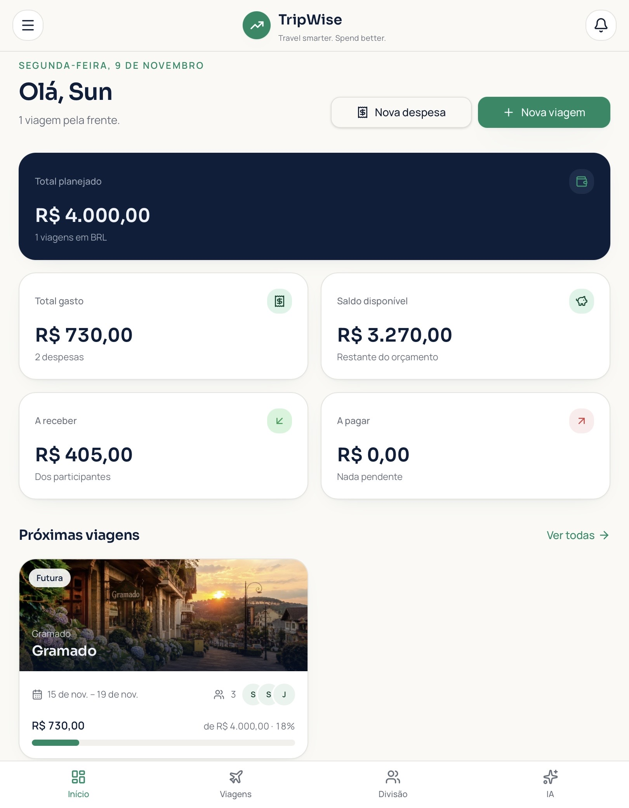
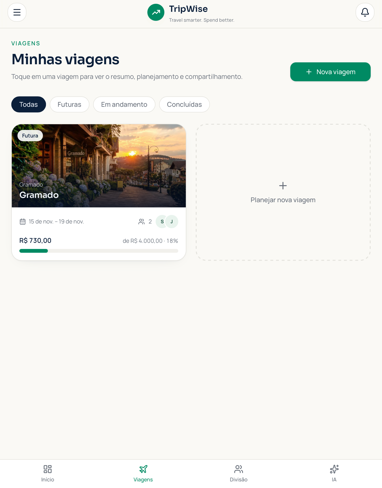
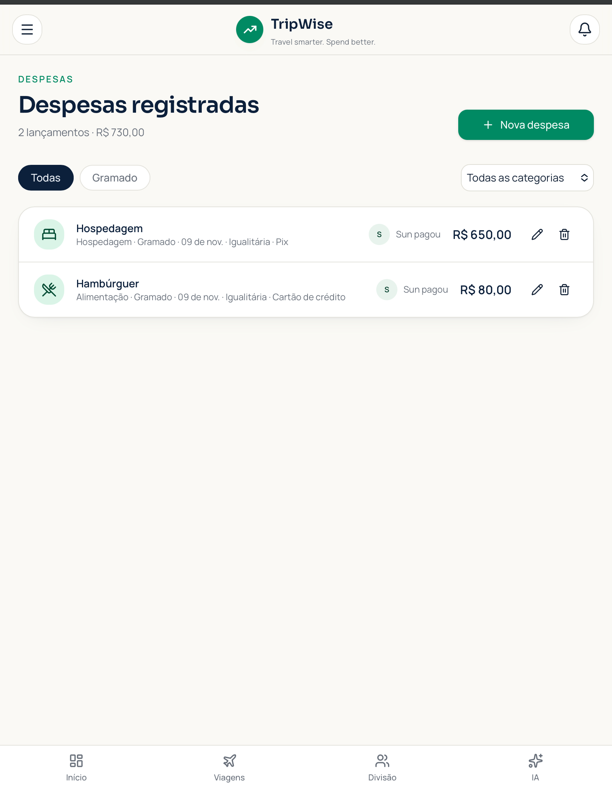
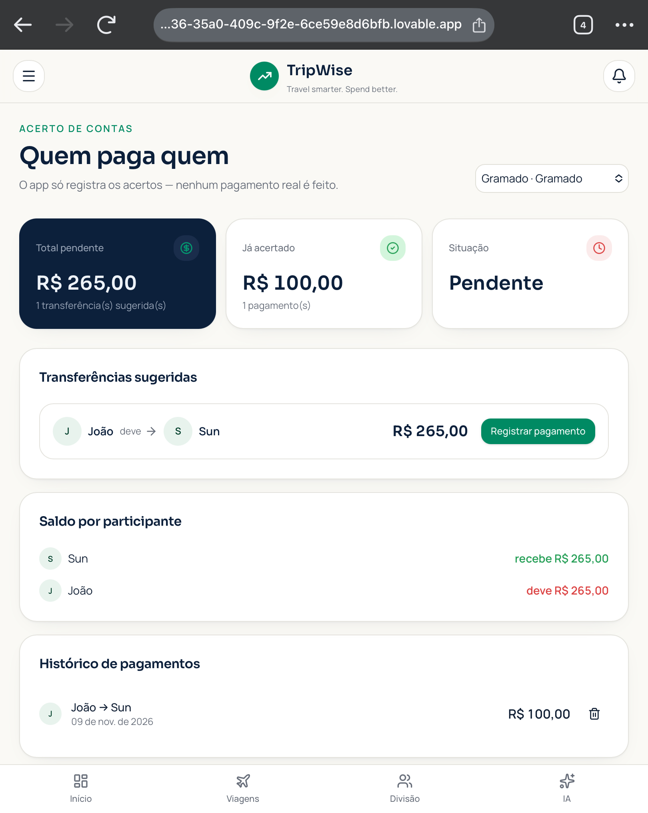

# ✈️ TripWise — Travel smarter. Spend better.

**Organize suas finanças e aproveite melhor cada viagem!**

O TripWise é uma aplicação web de organização financeira voltada para viajantes. Desenvolvido como parte do desafio da DIO, utilizando a abordagem de *Vibe Coding* com auxílio de inteligência artificial.

A proposta é facilitar o planejamento financeiro de viagens, o acompanhamento de despesas e a divisão de custos entre participantes.

## 🎯 Objetivo

Desenvolver uma solução que ajude viajantes individuais, casais e grupos a controlar seus gastos antes, durante e depois de uma viagem.

## 🚀 Funcionalidades

- **Dashboard financeiro:** valores planejados, gastos, saldo disponível e acertos.
- **Gestão de viagens:** criação, edição e exclusão de viagens.
- **Controle de despesas:** registro e organização de despesas por categoria.
- **Divisão de despesas:** rateio igualitário, por valores personalizados, porcentagem ou despesas individuais.
- **Acerto de contas:** identificação de quem deve pagar e quem deve receber.
- **Pagamentos parciais e totais:** registro de pagamentos e atualização dos saldos.
- **Assistente financeiro:** consulta de informações sobre os dados registrados.
- **Relatórios:** comparação entre valores planejados e realizados.
- **Perfil e configurações:** personalização de dados e preferências.

## 🧪 Testes realizados

| Cenário | Resultado |
|---|---|
| Divisão de R$ 240,00 entre quatro pessoas | Aprovado |
| Validação de valores personalizados | Aprovado |
| Registro de pagamento parcial | Aprovado |
| Registro de pagamento total | Aprovado |
| Atualização dos saldos e histórico | Aprovado |
| Persistência após recarregar a página | Aprovado |
| Conferência em dispositivos móveis e desktop | Aprovado |

### Exemplo de acerto de contas

Uma dívida de R$ 365,00 foi quitada em dois pagamentos:

- Primeiro pagamento: R$ 100,00.
- Segundo pagamento: R$ 265,00.
- Saldo pendente final: R$ 0,00.

## 🛠️ Tecnologias e ferramentas

- TypeScript
- React
- Vite
- CSS
- Lovable
- GitHub

## 🤖 Desenvolvimento com inteligência artificial

O projeto foi desenvolvido com a abordagem de Vibe Coding, utilizando inteligência artificial como apoio na concepção, estruturação e implementação da aplicação.

Etapas do desenvolvimento:

1. Definição do problema e da proposta de solução.
2. Planejamento das funcionalidades e dos requisitos.
3. Criação da interface e das telas.
4. Implementação das regras de negócio e cálculos financeiros.
5. Testes funcionais e identificação de inconsistências.
6. Refinamento da aplicação a partir dos resultados dos testes.

## 🔒 Observações técnicas

- Os dados são armazenados localmente no navegador.
- A persistência utiliza o armazenamento local do dispositivo.
- O assistente financeiro possui respostas simuladas, não sendo uma integração com um modelo de IA em produção.
- O aplicativo não realiza transferências bancárias reais.
- Login, sincronização entre dispositivos e compartilhamento efetivo entre usuários dependem de infraestrutura backend.

## 🌐 Acesse o projeto

**Aplicação publicada:** https://tripwiseapp.lovable.app

**Repositório GitHub:** https://github.com/sunmilyoliveira/TripWise

## 📸 Demonstração

Capturas de tela das principais funcionalidades:

### Dashboard financeiro

### Gestão de viagens

### Despesas

### Acerto de contas

### Relatórios financeiros

## 💡 Aprendizados

O desenvolvimento do TripWise proporcionou a oportunidade de trabalhar com planejamento de requisitos, construção de interfaces, regras de negócio, lógica de programação, persistência de dados e testes funcionais.

Também permitiu compreender melhor o potencial e as limitações do desenvolvimento assistido por inteligência artificial, especialmente a importância de validar os resultados gerados e testar as funcionalidades antes de considerar uma aplicação concluída.

---

**TripWise — Travel smarter. Spend better.**
